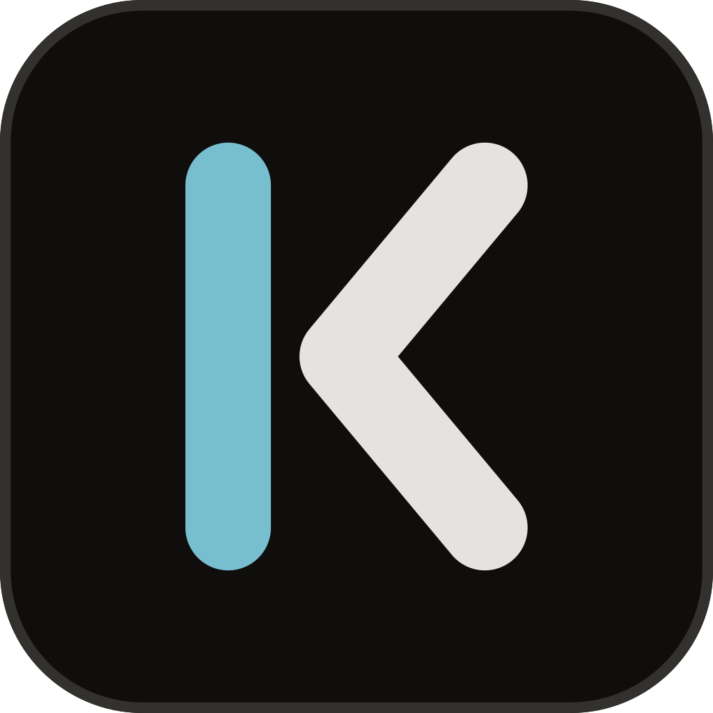

<p align="center">
  
</p>

<h1 align="center">Kynex</h1>

<p align="center">A fast, native desktop workspace for interactive AI agent CLIs, written in Rust.</p>

<p align="center">
  <a href="https://github.com/mrbergeron83/kynex/actions/workflows/ci.yml"></a>
  <a href="https://github.com/mrbergeron83/kynex/actions/workflows/security.yml"></a>
  <a href="https://scorecard.dev/viewer/?uri=github.com/mrbergeron83/kynex"></a>
  <a href="https://github.com/mrbergeron83/kynex/releases/latest"></a>
  <a href="LICENSE"></a>
</p>

## What it is

Kynex is a native desktop workspace for running interactive agent CLIs — **Claude Code** (`claude`), **Antigravity** (`agy`), **Grok Build** (`grok`), and any CLI configured via `agent_rules` (`codex`, `copilot`, `cursor`, `opencode`, or your own) — side by side across projects and git worktrees.

Instead of wrapping CLIs in a custom chat protocol, Kynex runs each provider's **native interactive CLI** inside a high-performance GPU-rendered terminal (`agent_cli` pane) built with Rust, [gpui](https://www.gpui.rs/), and `alacritty_terminal`. Every CLI keeps its own TUI, slash commands, permissions, MCP servers, and native auto-updater. For **Claude Code** and **Antigravity**, Kynex also provides one-click **OpenRouter** overrides backed by your OS keychain.

## Features

- **Pure native CLIs in GPU terminal panes (`agent_cli`):** Start any session with a keyboard-first inline provider picker (`Claude Code`, `Claude Code (OpenRouter)`, `Antigravity`, `Antigravity (OpenRouter)`, `Grok Build`, `Codex`, `Copilot`, `Cursor`, `opencode`, and custom rules in `<data dir>/agents/`).
- **Live status hooks & Agents pane:** Native CLI hooks (`knx hook`) and screen-pattern fallback report when each agent is working, needs your input, or finished — powering status lamps on project tabs, the Sessions tree, the Agents pane (`Ctrl+Shift+J`), and optional OS notifications while Kynex is in the background.
- **Workspaces & Sessions tree:** Organize projects into tabs with git worktrees, extra folders, session groups, pins, archive, search, and one-click resume for past sessions.
- **Hyprland-style tiling panes:** Split, move, swap, resize, zoom, undo/redo layouts, and save/restore named layouts with tmux-style prefix keys (`Ctrl+B`).
- **Built-in Git pane & plain Terminals:** Stage, commit, inspect diffs/history/branches, manage worktrees, and open plain PowerShell/bash/zsh panes with find and copy mode.
- **Storage cleanup:** Measure disk usage of Claude Code session logs, scratchpads, and checkpoints, and clean up old sessions safely.

## Install

Windows (PowerShell, no admin needed; run it again to update):

```powershell
irm https://raw.githubusercontent.com/mrbergeron83/kynex/main/install.ps1 | iex
```

macOS (Apple silicon) and Linux (x86_64), no sudo needed; run it again to update:

```sh
curl -fsSL https://raw.githubusercontent.com/mrbergeron83/kynex/main/install.sh | sh
```

Both install the latest release, verify it against `SHA256SUMS`, and add the `knx` CLI. Archives are also on the [releases page](https://github.com/mrbergeron83/kynex/releases).

## Scripting a running Kynex (`knx`)

`knx` talks to the running Kynex over a per-user local socket (named pipe on Windows, Unix domain socket on macOS/Linux). Each command prints one JSON line.

```sh
knx <folder>                                  # open a folder in the running Kynex (or start on it)
knx project list | create <folder> | open <folder> | remove <folder>
knx workspace list | open <folder> | create <branch> [--provider <id>] | remove <folder> [--force]
knx pane list [--all] | split [row|column] | focus <id> | close [id]
knx pane move <id> left|right|up|down | swap <id> <other>
knx pane resize <id> left|right|up|down [--by <px>] | zoom <id> [--off]
knx pane read <id> [--lines N]
knx pane run <id|new> <command…> [--wait] [--timeout <secs>]
knx pane prompt <id> <message…> [--wait] [--timeout <secs>] | wait <id>
knx session list | new [--workspace <folder>] [--provider <id>] [--model <m>] [--pane right|down]
knx session open <session id> [--pane right|down] | rename <id> <title…> | archive <id> | pin <id> [--off]
knx events                                    # stream turn_end, needs_you, and agent_state events
knx api schema                                # JSON schema for all requests, answers, and events
```

## OpenRouter overrides

Add your OpenRouter key in **Settings → Providers** (stored in the OS keychain, never in Kynex's files), pick your models under **My models**, and select **Claude Code (OpenRouter)** or **Antigravity (OpenRouter)** in any new-session picker. Native **Claude Code** and **Antigravity** sessions stay completely untouched.

## Shortcuts

Use Cmd instead of Ctrl on macOS. Rebind any shortcut in `keymap.json` (**Settings → Keyboard**).

| Keys | Does |
| --- | --- |
| Ctrl+K | Command palette: sessions, projects, providers, and actions |
| Ctrl+N | New session (opens the inline provider picker) |
| Ctrl+O | Open project folder |
| Ctrl+W | Close pane (or project tab) |
| Ctrl+Shift+G | Toggle Git pane |
| Ctrl+Shift+J | Toggle Agents pane |
| Ctrl+Shift+A | Jump to next agent that needs you |
| Ctrl+` | Toggle plain terminal pane |
| Ctrl+B then v / - | Split pane right / down |
| Ctrl+B then h/j/k/l | Focus neighbouring pane |
| Ctrl+B then z / x | Zoom / close pane |
| Ctrl+B then y | Terminal copy mode |
| Ctrl+, | Settings |

## Links

- [Changelog](CHANGELOG.md)
- [Contributing and building from source](.github/CONTRIBUTING.md)
- [Report a bug or suggest an idea](https://github.com/mrbergeron83/kynex/issues/new/choose)
- [Security policy](.github/SECURITY.md)

## License

Copyright © 2026 Michael Bergeron. Kynex is free software under the
[GNU General Public License v3.0 or later](LICENSE). Third-party notices are in [NOTICE.md](NOTICE.md).
