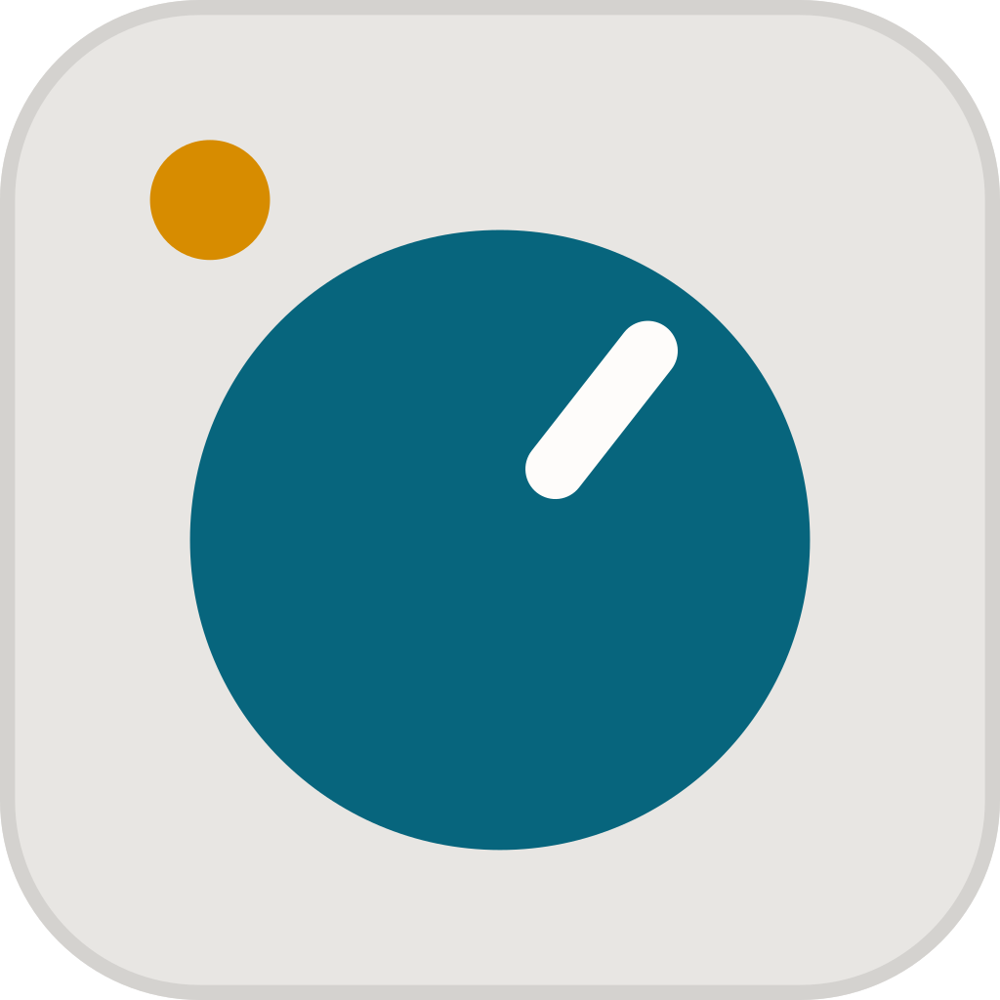

<p align="center">
  <picture>
    <source media="(prefers-color-scheme: dark)" srcset="docs/design/branding/mark-dark.svg">
    
  </picture>
</p>

<h1 align="center">Kynex</h1>

<p align="center">A fast, native desktop workspace for Claude Code, written in Rust.</p>

<p align="center">
  <a href="https://github.com/mrbergeron83/kynex/actions/workflows/ci.yml"></a>
  <a href="https://github.com/mrbergeron83/kynex/actions/workflows/security.yml"></a>
  <a href="https://scorecard.dev/viewer/?uri=github.com/mrbergeron83/kynex"></a>
  <a href="https://github.com/mrbergeron83/kynex/releases/latest"></a>
  <a href="LICENSE"></a>
</p>

Kynex drives your installed `claude` CLI over its stream-json protocol, so it uses whatever
account `claude` is logged into. No API key needed. It runs on Windows, macOS and Linux.

## Features

- **Sessions per project:** several Claude Code sessions per folder, streaming transcripts with
  tool calls and edits shown as diffs, unread markers and turn recaps.
- **Prompts as buttons:** permission requests, plans and questions are answered in place of the
  composer; set the permission mode, effort and extra directories per project.
- **Context at a glance:** how full the context is, and compact it in one click.
- **Git view:** branches, stage and commit, diffs, history, fetch / pull / push, worktrees.
- **Built-in terminal:** PowerShell or Git Bash under the conversation; play buttons run the
  commands Claude suggests.
- **No terminal needed:** installs Claude Code, signs you in and keeps it updated; Kynex updates
  itself from its GitHub releases.
- Image attachments (paste, drop or pick), a model picker, and a Chat tab for plain conversation.

## Install

Windows (PowerShell, no admin needed; run it again to update):

```powershell
irm https://raw.githubusercontent.com/mrbergeron83/kynex/main/install.ps1 | iex
```

macOS (Apple silicon) and Linux (x86_64), no sudo needed; run it again to update:

```sh
curl -fsSL https://raw.githubusercontent.com/mrbergeron83/kynex/main/install.sh | sh
```

Both install the latest release, verify it against `SHA256SUMS`, and add a `knx` command to
start Kynex from a terminal. Archives are also on the
[releases page](https://github.com/mrbergeron83/kynex/releases), each with a build provenance
attestation (`gh attestation verify <archive> --repo mrbergeron83/kynex`). Builds are not
code-signed yet.

## Quick start

1. Start Kynex. If Claude Code isn't installed or signed in, Kynex offers to do both.
2. Add a project folder (button or drag and drop) and start a session.
3. Answer permission prompts as they come, or pick a permission mode in the project settings.

## Links

- [Changelog](CHANGELOG.md)
- [Contributing and building from source](CONTRIBUTING.md)
- [Report a bug or suggest an idea](https://github.com/mrbergeron83/kynex/issues/new/choose)
- [Security policy](SECURITY.md)

## License

Copyright © 2026 Michael Bergeron. Kynex is free software under the
[GNU General Public License v3.0 or later](LICENSE): use it for anything, including paid
work, and fork or change it as you like, as long as anything you distribute stays under the
same license with its source available. Third-party notices are in [NOTICE.md](NOTICE.md).

The license covers the code, not the name: forks should go by a different name and logo,
so nobody mistakes them for Kynex.
