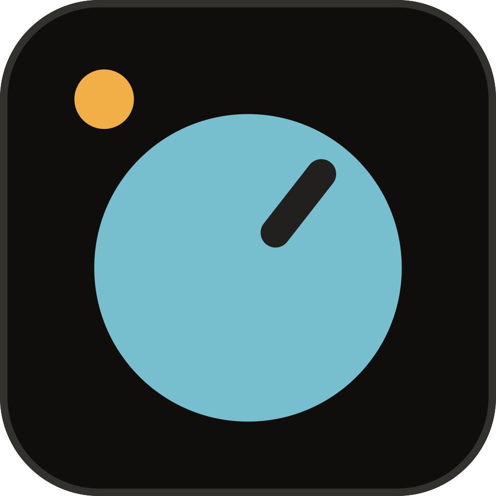

<p align="center">
  
</p>

<h1 align="center">Kynex</h1>

<p align="center">A fast, native desktop workspace for Claude Code, written in Rust.</p>

<p align="center">
  <a href="https://github.com/mrbergeron83/kynex/actions/workflows/ci.yml"></a>
  <a href="https://github.com/mrbergeron83/kynex/actions/workflows/security.yml"></a>
  <a href="https://scorecard.dev/viewer/?uri=github.com/mrbergeron83/kynex"></a>
  <a href="https://github.com/mrbergeron83/kynex/releases/latest"></a>
  <a href="LICENSE"></a>
</p>

## What it is

Kynex is a desktop app for working with [Claude Code](https://claude.com/claude-code). It runs
your installed `claude` CLI behind the scenes, so you get the same agent, tools, skills, MCP
servers and settings, with the same account and quota. You don't need an API key. It runs on
Windows, macOS and Linux.

## Why use it

Claude Code in a terminal works well for one task at a time. Once you have several projects
and sessions going, Kynex keeps them easier to follow:

- **All your work in one window.** Projects are tabs, and each project has its own sessions,
  grouped, pinned and searchable. A session keeps running when you switch away, and a dot
  tells you when one finishes or needs an answer, even if Kynex is in the background.
- **Readable transcripts.** Edits show as diffs, runs of tool calls fold into one line ("Edited
  app.rs ×3, read 2 files"), code is highlighted, and file paths open in your editor.
- **Prompts you click instead of type.** Permission requests, plans and questions take the
  message box's place, with numbered choices and the same keys as Claude Code.
- **Less switching between apps.** A Git view, a terminal, a timeline of each session and an
  image viewer are all in the window.
- **No terminal setup.** Kynex installs Claude Code, signs you in and keeps it and itself
  up to date.
- **Native and fast.** Written in Rust on [gpui](https://www.gpui.rs/), Zed's UI framework.
  It isn't a web view, so long conversations scroll smoothly.

## Features

- **Sessions per project:** several Claude Code sessions per folder, groups and an archive,
  unread markers, turn recaps with time and cost, and a Chat tab for plain conversation.
- **Composer:** image attachments (paste, drop or pick), `@file` mentions, slash commands,
  message history, and a queue for messages you write while Claude works.
- **Rewind:** go back to an earlier message and restore the conversation, the files, or both.
- **Context and limits:** how full the context is (compact it in one click), and your 5-hour
  and weekly usage.
- **Git view:** branches, stage and commit, diffs, history, fetch / pull / push, worktrees.
- **Built-in terminal:** PowerShell, Git Bash or your shell under the conversation; play
  buttons run the commands Claude suggests.
- **Background tasks:** see what's running, watch its output live, stop it.
- **Extensions:** add, check and remove MCP servers, including a one-click browser server.
- **Find anything:** command palette (Ctrl+K) and find in the conversation (Ctrl+F).
- **Storage:** see how much disk sessions use and clean up old ones.

## Install

Windows (PowerShell, no admin needed; run it again to update):

```powershell
irm https://raw.githubusercontent.com/mrbergeron83/kynex/main/install.ps1 | iex
```

macOS (Apple silicon) and Linux (x86_64), no sudo needed; run it again to update:

```sh
curl -fsSL https://raw.githubusercontent.com/mrbergeron83/kynex/main/install.sh | sh
```

Both install the latest release, verify it against `SHA256SUMS`, and add a `knx` command to
start Kynex from a terminal. Archives are also on the
[releases page](https://github.com/mrbergeron83/kynex/releases), each with a build provenance
attestation (`gh attestation verify <archive> --repo mrbergeron83/kynex`). Builds are not
code-signed yet.

## User guide

### First start

1. Start Kynex. If Claude Code isn't installed or signed in, Kynex offers to do both.
2. Add a project folder with the button, or drag the folder onto the window. Each project
   gets its own tab and colour.
3. Start a session (Ctrl+N) and type what you want done.

### Talking to Claude

- **Enter** sends, and **Ctrl+J** adds a new line. Type `/` for slash commands and `@` to
  mention a file or folder. Paste or drop images to attach them.
- While Claude works, **Enter** queues your message for when the turn ends. **Ctrl+Enter**
  stops Claude and sends it now, and **Esc** stops Claude.
- **↑ / ↓** go through messages you've sent, and **Ctrl+R** searches them. **Ctrl+S**
  stashes a draft, and **Ctrl+G** opens it in your editor.
- **Esc Esc** on an empty message box opens Rewind: pick a message to go back to it, with or
  without the file changes made after it.
- The chip under the message box picks the model and effort.

### Answering prompts

When Claude asks for permission, shows a plan or asks a question, the prompt takes the
message box's place. Pick a choice with its number or the arrow keys. **Shift+Tab** allows an
action for the rest of the session, and **Tab** on Yes lets you add a comment ("yes, but use
the staging config"). To be asked less often, set the permission mode in the project's
Claude settings (the shield in the toolbar).

### Around the window

- **Sessions panel** (left): right-click a session to rename, pin, group or archive it, or
  drag it into a group.
- **Timeline** (Ctrl+Shift+T): every message you sent with the files edited and commands run
  in that turn. Click a step to jump to it.
- **Terminal** (Ctrl+`): a shell under the conversation. The Run button on a code block runs
  its command there.
- **Git**: the Code / Git switch in the toolbar, or a branch chip over the conversation,
  opens the Git view to stage, commit, see diffs and history, and pull or push.
- **Status footer**: CPU and memory of Kynex and its processes, your usage limits, and
  updates waiting to be installed.

### Shortcuts

Use Cmd instead of Ctrl on macOS. You can rebind any of these in `keymap.json` (Settings →
Keyboard).

| Keys | Does |
| --- | --- |
| Ctrl+K | Command palette: sessions, tabs and actions |
| Ctrl+F | Find in the conversation |
| Ctrl+N | New session |
| Ctrl+PageUp / PageDown | Previous / next session |
| Ctrl+W | Close the project tab |
| Ctrl+, | Settings |
| Ctrl+` (Ctrl on macOS too) | Terminal |
| Ctrl+Shift+T | Timeline |
| Ctrl+= / Ctrl+- / Ctrl+0 | Zoom in / out / reset |
| Alt+P | Model picker |
| Esc | Stop Claude |

### Settings

The gear in the title bar (Ctrl+,) has Kynex's own settings: which `claude` to use, the
default shell, theme, fonts, zoom, notifications, keep-awake, and Storage for cleaning up old
sessions. Each project's Claude settings (the shield in the toolbar) hold its permission
mode, effort, extra folders and rules.

## Links

- [Changelog](CHANGELOG.md)
- [Contributing and building from source](.github/CONTRIBUTING.md)
- [Report a bug or suggest an idea](https://github.com/mrbergeron83/kynex/issues/new/choose)
- [Security policy](.github/SECURITY.md)

## License

Copyright © 2026 Michael Bergeron. Kynex is free software under the
[GNU General Public License v3.0 or later](LICENSE): use it for anything, including paid
work, and fork or change it as you like, as long as anything you distribute stays under the
same license with its source available. Third-party notices are in [NOTICE.md](NOTICE.md).

The license covers the code, not the name: forks should go by a different name and logo,
so nobody mistakes them for Kynex.
