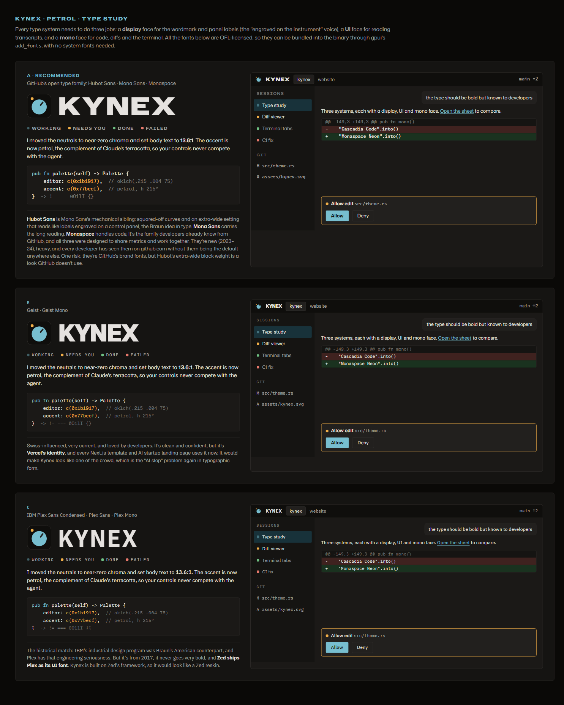

# Kynex brand: Instrument · Petrol

Status: **implemented in v0.0.1** (2026-10-26), with these gaps:

- **Fonts changed after trying them in the app:** Mona Sans read oddly in the UI, so the
  interface uses **IBM Plex Sans** and code, diffs, git and the terminal use **JetBrains Mono**
  (Monaspace dropped). Hubot Sans stays for the wordmark and section labels. Both the interface
  and code font can be changed in the theme menu; the type section below is the original study.
- Hubot Sans 1.0 ships no SemiExpanded cut, so labels use Expanded SemiBold; gpui has no
  letter-spacing, so the tracking values aren't applied.
- No red "failed" lamp yet: sessions don't track a failed state.
- Icons: Windows `.ico` is embedded (`assets/icons/`, drawn by `make-icons.py`); Linux PNGs
  are generated but not wired to a desktop file, and there's no macOS `.icns` until there's an
  app bundle.



| File | What |
| --- | --- |
| `branding/mark-dark.svg` | Master mark: the one look, on light and dark backgrounds alike |
| `branding/colour-study.png` / `.html` | Petrol vs Cobalt vs Graphite; **Petrol (top board) chosen** |
| `branding/type-study.png` / `.html` | Type systems A/B/C; **A (top board) chosen** |
| `branding/round-2-directions.png` | Earlier directions (Kare, Indigo, Instrument, Crossing), for context |

The `.html` sources render the boards live (fonts load from Google Fonts / jsDelivr). The palette is
written in OKLCH there; the hex values below come from the same numbers.

## Idea

Kynex is a **control panel for an agent that works on its own**. You mostly *read* (transcripts,
diffs) and sometimes *act* (approve, answer, send). Control panels solved this colour problem long
ago, so Kynex follows the Braun / Dieter Rams line: a quiet housing, one control, and indicator lamps
whose colour is information, never decoration.

Four rules drive every decision:

1. **The housing is almost colourless.** Neutrals sit at OKLCH chroma ≤ 0.008, hue 75° (a faint
   warm tint, like Braun's off-white plastic). A tinted mid-tone ground was rejected as tiring.
2. **Colour means state.** Lamp colours follow IEC 60073, the standard for machine indicator lamps:
   green = normal/done, amber = needs attention, red = fault. Lamps share one lightness per mode, so
   only "needs you" (amber, with extra chroma) stands out.
3. **The agent and the operator get opposite hues.** Claude is warm terracotta (h≈40°). The
   operator colour, **Petrol** (h 215–222°), is its complement and is used only for *your* controls:
   primary buttons, focus, selection, links, and the knob in the mark.
4. **Contrast is set by measurement.** Body text is about 13–14:1, not 21:1 (pure black on white
   glares over long reading); muted text ≥ 6:1. In dark mode the accent gains lightness and loses
   chroma so it doesn't bloom (halation).

## The mark

A device seen from the front: a housing, one **knob** (the operator control, in petrol) and one
**indicator lamp** (session state).

The mark has **one look**, the dark one, whatever the theme or the viewer's colour scheme: its own
dark housing is the background, so it reads on a light title bar too. Geometry on a 100×100
canvas (see the SVG); the colours are the dark palette's:

| Part | Shape | Colour token |
| --- | --- | --- |
| Housing | rect 100×100, rx 20 | `#0f0e0c` (dark `title_bar`) |
| Rim | 1.5 stroke, inset .75, rx 19.25 | `#33312e` (dark `border`) |
| Knob | circle (50, 54) r 31 | `#77becf` (dark `accent`) |
| Pointer | rect x 47 y 27, 6×21, rx 3, rotated 38° about (50, 54) | `#22201e` (dark `elevated`) |
| Lamp | circle (21, 20) r 6 | state colour (static icon: amber `#f2af48`) |

Behaviour in the app (the mark is live, not just a logo):

- **Title bar icon:** the lamp shows the shown session's state: accent pulsing (1.6 s ease) =
  working, amber = needs you, green = done, red = failed, no lamp = idle. While working, the pointer
  may sweep ±40° (2.4 s ease-in-out, alternate).
- **Taskbar / dock:** the app icon is the static mark. Showing "needs you" on the taskbar (Windows
  overlay icon, macOS dock badge) is a later nice-to-have.
- Below ~20 px the rim and pointer can be dropped; the knob and lamp still carry it.

App icon files to generate from `mark-dark.svg`: Windows `.ico` (16, 20, 24, 32, 40, 48, 64, 256),
macOS `.icns` (16–1024 @1x/2x), Linux PNGs (16–512) + SVG, all from the dark mark.

## Colour

Add a `Theme::Kynex` (light + dark, or two variants `KynexLight` / `KynexDark`) to `src/theme.rs`
and make it the default. The existing themes stay.

### Palette tokens

| Token | Light | Dark | Notes |
| --- | --- | --- | --- |
| `title_bar` | `#e8e6e3` | `#0f0e0c` | housing |
| `panel` | `#f0edea` | `#151412` | side panels |
| `editor` | `#f9f7f5` | `#1b1917` | reading surface |
| `elevated` | `#fefcfa` | `#22201e` | popovers, prompts |
| `border` | `#d4d2cf` | `#33312e` | |
| `border_variant` | `#e2dfdc` | `#282624` | |
| `border_focused` | `#07657d` | `#77becf` | = accent |
| `text` | `#292622` | `#e5e2df` | 14.1:1 / 13.6:1 on editor |
| `text_muted` | `#5d5a56` | `#a7a4a0` | 6.4:1 / 7.1:1 |
| `text_placeholder` | `#888682` | `#777471` | |
| `accent` | `#07657d` | `#77becf` | **Petrol**; 6.2:1 / 8.4:1 |
| `hover` | `#e8e6e3` | `#252421` | |
| `active` | `#dedcd9` | `#2e2c29` | |
| `element` | `#f0edea` | `#22201e` | inputs, code blocks |
| `selection` | `#d7ecf4` | `#18323a` | petrol tint, opaque |
| `success` | `#348f4f` | `#6fc082` | lamp: done |
| `warning` | `#d78c00` | `#f2af48` | lamp: needs you |
| `error` | `#c8443a` | `#e8796c` | lamp: failed |
| `info` | `#07657d` | `#77becf` | = accent |

Text on an accent fill: light mode white (`#ffffff`), dark mode `title_bar` (`#0f0e0c`).

New tokens this calls for (a `Palette` struct change, so do it in a worktree):

| Token | Light | Dark | Use |
| --- | --- | --- | --- |
| `diff_add` | `#d9f3dd` | `#1a321f` | added-line background |
| `diff_del` | `#ffe3de` | `#3f221f` | removed-line background |

The source values, for regenerating or tuning in OKLCH (L C h):

```
neutral hue 75°   light: title .925/.005  panel .948/.005  editor .978/.004  elevated .992/.003
                         border .865/.005  border_variant .905/.005  text .27/.008  muted .47/.008
                         placeholder .62/.006  active .895/.005
                  dark:  title .165/.004  panel .192/.004  editor .215/.004  elevated .245/.005
                         border .315/.006  border_variant .27/.005  text .915/.006  muted .72/.007
                         placeholder .56/.006  hover .26/.005  active .295/.006
petrol            light .47 .085 222    dark .76 .075 215    selection light .93 .025 222 / dark .30 .035 222
lamps (IEC 60073) light: green .58 .13 150  amber .70 .15 72  red .57 .17 28
                  dark:  green .74 .12 150  amber .80 .14 75  red .70 .14 28
diff bg           light: add .94 .04 150  del .94 .035 28    dark: add .29 .045 150  del .29 .045 28
```

### Rules for using colour

- Petrol appears only on things **you** operate or have focused: the primary button, focus ring,
  selection, links, the active session row (as `selection`). Never on headings or decoration.
- Status colours appear only as **lamps** (7 px dots), status text, and diff signs. Session rows
  get a lamp: working (accent, pulsing), needs you (amber), done (green), failed (red), idle
  (hollow ring in `text_placeholder`).
- A permission / question prompt gets an amber 1 px border: it's the one "needs you" surface.
- No gradients, glows or shadows beyond what gpui needs for popovers.

## Type: system A

| Role | Family | Settings | Used for |
| --- | --- | --- | --- |
| Display | **Hubot Sans** | Expanded (wdth 125), ExtraBold/Black (800–900), tracking +0.04 em, uppercase | wordmark "KYNEX", splash/setup screen headings |
| Labels | **Hubot Sans** | SemiExpanded (wdth ~112), SemiBold 600, uppercase, tracking +0.16 em, 10–11 px | section labels (SESSIONS, GIT), lamp captions, title-bar wordmark |
| UI | **Mona Sans** | wdth 100, Regular 400 / SemiBold 600–650 | everything you read: transcript, menus, buttons |
| Code | **Monaspace Neon** | Regular / Bold | code blocks, diffs, terminal (replaces the `mono()` pick) |
| Code labels | **Monaspace Krypton** | Regular | file paths, branch names, small metadata |

Why: Hubot Sans is Mona Sans's mechanical sibling, with squared-off curves and an extra-wide
setting that reads like lettering engraved on a control panel, the Braun idea in type. Mona Sans
carries long reading. Monaspace is the code family developers know from GitHub, and all three share
metrics by design. They're new (2023–24), go very bold, and no other app uses them as its main
fonts. Rejected: Geist (Vercel's identity, everywhere), IBM Plex (Zed's UI font, so Kynex would look
like a Zed reskin).

Sources (all SIL OFL 1.1, so they can be bundled with the binary; ship the licence files):

- Mona Sans: <https://github.com/github/mona-sans>
- Hubot Sans: <https://github.com/github/hubot-sans>
- Monaspace: <https://github.com/githubnext/monaspace>

## Implementation notes

- **Bundle the fonts**, don't depend on installed ones: put the TTFs under `assets/fonts/` and
  register them at startup with `cx.text_system().add_fonts(vec![Cow::Borrowed(include_bytes!(…))])`
  in `theme::init_fonts`. Then `mono()` returns "Monaspace Neon" directly, with the current
  installed-font search kept as a fallback.
- **Width axis:** gpui's font API selects family, weight and style but (as far as we know) not
  width. Use the **static instances** the releases ship (e.g. the "Hubot Sans Expanded" family) rather
  than the variable font. Check how DirectWrite / Core Text / fontconfig expose those family names
  on each OS.
- Only bundle the weights we use (Hubot Expanded 800/900, SemiExpanded 600; Mona 400/600; Monaspace
  Neon 400/700, Krypton 400) to keep the binary small.
- Struct changes (`diff_add`/`diff_del`, lamp state in the title bar, a new `Theme` variant) can't
  be hot-patched: do them in a git worktree with `KYNEX_DATA_DIR` set (see CLAUDE.md).
- Saved `state.json` stores the `Theme` enum by name; adding a variant is backward compatible.

## Order of work

1. `Theme::Kynex` light + dark tokens in `theme.rs`, made the default.
2. Bundle fonts; switch UI, labels and `mono()` over.
3. `diff_add` / `diff_del` tokens; use them in the transcript diffs and the Git diff viewer.
4. Lamps on session rows; amber border on prompts.
5. Live mark in the title bar (lamp state, pointer sweep while working).
6. App icon files from the SVGs, wired into the Windows resource / macOS bundle / Linux desktop file.
