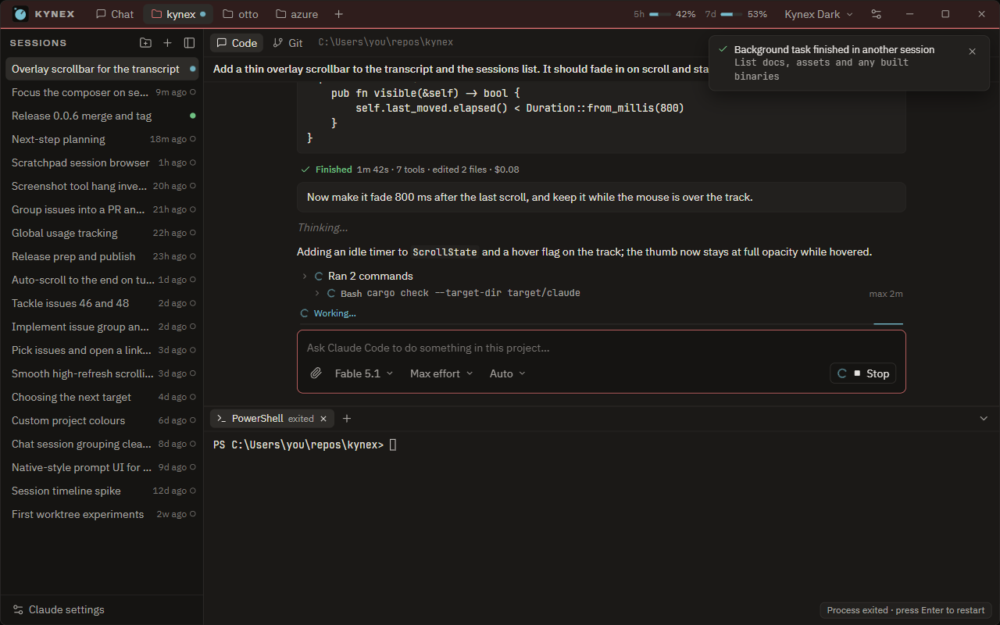
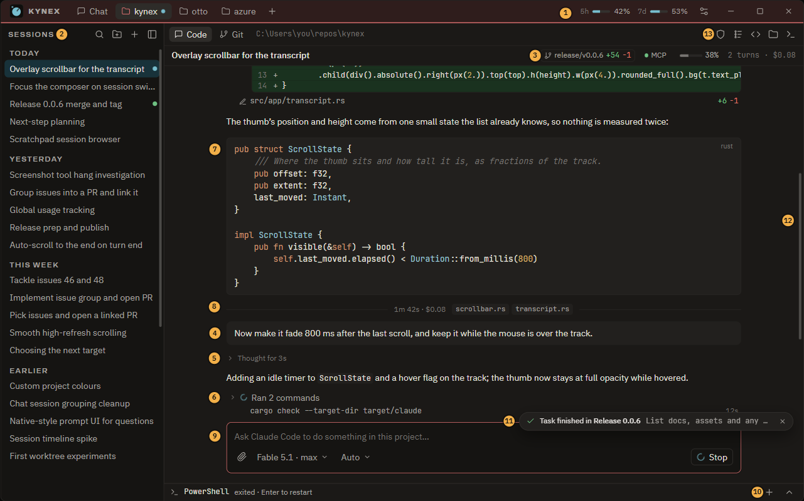

# Kynex UX review, October 2026

Status: **proposal**, filed as issues #114–#138 (with #107 and #111); the sizes and colours are in #138. Written against 0.0.6 (`a7021ed`) from the source and a screenshot of the
Windows build at 2560×1380. It is one reading of the app; the Git view, settings and prompts were
reviewed from code only.

The goal it measures against is the one in the README and the brand doc: a quiet housing you
mostly *read* in, one control colour, lamps for state, and nothing that fights for attention. The
yardstick for every item below: does it remove something the user has to look past, or add
something they reach for every session? Anything else is bloat and stays out.

| | |
| --- | --- |
|  |  |
| **Before**: 0.0.6 as it draws, same session | **After**: the proposal (numbers match the legend in the page) |

`before-after.html` draws both windows from the same data, with toggles for dark / light, the
numbered notes, an `@file` completion and the Ctrl+K palette. Open it from a server rooted at
the repo (`python -m http.server` then `/docs/design/before-after.html`) so the bundled fonts
load; from `file:` it falls back to system fonts.

## What already works, and stays

- The frame: flat surfaces, 1 px borders, one accent, lamps in IEC colours, the project colour
  on the bar and the composer. It reads as one thing.
- Prompts in the composer's place, with Claude Code's keys. Queued messages. Rewind.
- Tool traffic folded into runs ("Ran 23 commands"); diffs on edits; images from tools.
- Glide scrolling, eased heights, panels that animate out. Reduce-motion honoured.
- A terminal under the conversation with play buttons on suggested commands.
- Installing, signing in and updating the CLI without a terminal; Kynex updating itself.

## What hurts, ranked by how often you meet it

1. **No scrollbar anywhere.** Not the transcript, the sessions list, the timeline, settings or
   the Git view (`grep -ri scrollbar src` finds only a comment). You can't see where you are in a
   long conversation or how long it is, and you can't drag. gpui-pre 0.3.10 has no scrollbar
   primitive, so this is a `src/ui/scrollbar.rs`: a 4 px thumb over the content, visible while
   scrolling or hovering the track, gone 800 ms later. Copy and trim gpui-component's, as the
   conventions say.
2. **Five "working" indicators at once.** While Claude works the title-bar mark pulses
   (`title_bar.rs`), the tab lamp pulses, the session row lamp pulses, the composer shows a
   "Working…" label with a spinner *and* a sliding bar (`composer.rs: working_bar`), the Stop
   button spins, and the run row spins. Keep the lamps (they're the design) and the Stop
   button's spinner; drop the strip.
3. **The session header repeats the first message.** Until the haiku-generated name arrives,
   `session_header.rs` shows the whole first message in medium weight across the full width,
   directly above the same message in the transcript. Show the generated name; until then the
   first eight words and an ellipsis, in regular weight. Name the *shown* session first
   (`titles.rs` names the 30 most recent in list order).
4. **Sessions panel noise.** Every past row carries a hollow idle ring and "9m ago"; forty rows
   look like forty dials. Group by day (#111), draw a lamp only when a session is working, waiting
   or just finished, and put the time in the tooltip. Thirty rows at 30 px also need the search in
   item 1 of the missing features.
5. **"Thinking…" never leaves.** `Item::Thinking` is a static italic line that stays in the
   transcript after the reply (`session.rs:713`, `transcript.rs`). Replace it with "Thought for
   6s", folded, holding the thinking text when the stream has it.
6. **Code and diffs are monochrome.** No syntax highlighting in transcript code blocks, tool
   diffs or the Git view. For a coding tool this is the largest visual gap, and the one users
   compare against first.
7. **An exited shell keeps 280 px.** The dock stays full height with "Process exited · press
   Enter to restart" in a corner. Collapse to a 28 px strip on exit (the strip restarts it on
   Enter) and give the height back to the conversation.
8. **A settings control in the chrome.** The title bar carries a "Kynex Dark ▾" theme picker.
   Theme, fonts and motion are in Settings → Appearance already; the bar should hold tabs, usage,
   the update pill, Settings and the window buttons.
9. **Toasts cover the header** (#107). Bottom-right, one line, above the composer's row of
   controls so they never sit on Stop or on the header's chips.
10. **The transcript column is 780 px on any window.** Fine at 1280, narrow at 2560. Let it grow to
    about 820–880 px and keep the header's chips aligned with it.
11. **Three pickers under the message box.** "Fable 5.1 ▾ · Max effort ▾ · Auto ▾" is a toolbar.
    Effort belongs in the model menu ("Fable 5.1 · max"); mode stays, because Shift+Tab cycles it.
12. **Paths aren't links.** `src/app/mod.rs:123` in a reply or a tool row is plain text. Make
    `path[:line]` open the editor (`Opener::Code` with `-g path:line`), in prose and in tool rows.

## Missing features, in the order they'd pay back

1. **Command palette (Ctrl+K).** Sessions across projects, actions with their shortcuts,
   settings pages, "rename session", "move to group", "fork". One surface, so no more buttons
   are needed for the next ten features.
2. **Find in the transcript (Ctrl+F)**, with match count and ↑ / ↓; search across a project's
   sessions from the palette. Both are absent today.
3. **Overlay scrollbars** (hurts, item 1).
4. **Syntax highlighting.** `syntect` with `fancy-regex` (pure Rust, no oniguruma build) and a
   trimmed syntax set, or `tree-sitter-highlight` with eight grammars. Cache per block next to the
   markdown cache in `src/markdown.rs`; highlight big blocks on the background executor.
5. **`@file` mentions** in the composer: `git ls-files` through a subsequence scorer, Tab to
   insert the path. Every coding agent UI has it; Claude Code already understands the mention.
6. **Session rename and pin.** The session menu has move / archive only; names come from haiku
   and can't be changed.
7. **This turn's changes.** The turn footer's file chips open the Git view filtered to those
   files; "revert this turn's edits" reuses the rewind's file checkpoints.
8. **Native notifications, opt-in,** when a turn ends or needs you while the window isn't active;
   today the taskbar flashes. The brand doc's "needs you" badge on the taskbar / dock icon goes with it.
9. **Thinking text with duration** (hurts, item 5).
10. **Follow the system theme; UI zoom** (Ctrl+= / Ctrl+−, gpui's rem size).
11. **Keys:** Ctrl+N new session, Ctrl+Shift+] / [ next / previous session, Ctrl+W close the
    project tab. All rebindable in `keymap.json` like the rest.
12. **Fork a session** (#27) and a per-project default model (the model is global today).

## Performance

- `render_composer` reads a project's Claude settings from disk every frame
  (`src/app/composer.rs:252`, `ClaudeSettings::load(&p.path).effort`). During a glide or an
  animation at 120 Hz that is 120 file reads a second. Cache per project; drop it when the
  settings modal saves.
- `timeline::turns(&s.items)` is rebuilt on every timeline render and again for Alt+↑ / ↓
  (`src/app/timeline.rs:49,70,128`). Cache it on `items.len()` as `Thread.rows` is.
- Session naming runs `claude -p --model haiku` once per unnamed session for the 30 most recent
  (`crates/kynex-core/src/titles.rs:42`), in the background and silently, the first time a
  project opens. Cheap, but it's quota the user didn't spend; name the shown session, and the
  rest on demand (or behind a setting).
- Good as is: markdown parsed once per change and cached (`src/markdown.rs`); rows laid out only
  when items come or go; one wake channel drains every session; dependencies at `opt-level = 2`
  in dev.

## Bloat to keep out

No marketplace, no suggested-prompt chips, no second sidebar, no built-in browser preview,
no onboarding tour, no telemetry dashboard, no multi-column chat. Features arrive as a key, a
palette entry or a quieter row, not as a new bar.

## Order of work

1. **Quiet** (one release): scrollbars, one working indicator, the header title, grouped sessions
   without rings and times, the terminal strip, toasts bottom-right, theme picker out of the bar,
   effort into the model menu, the two per-frame caches. All visual; the rest of the app is unchanged.
2. **Find** : the Ctrl+K palette with session search, Ctrl+F in the transcript, rename and pin.
3. **Read** : syntax highlighting in the transcript, tool diffs and the Git view; "Thought for Ns".
4. **Reach** : `@file` mentions, clickable paths, this turn's changes, notifications.
